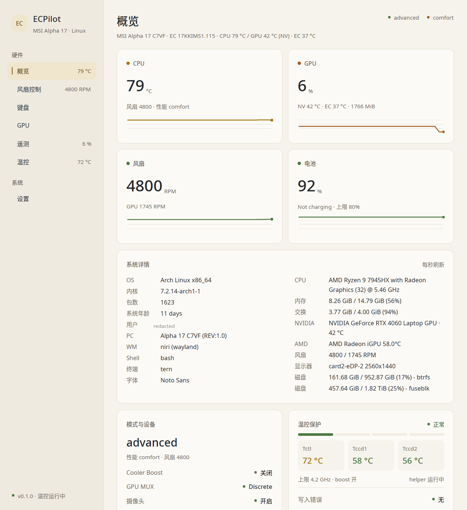
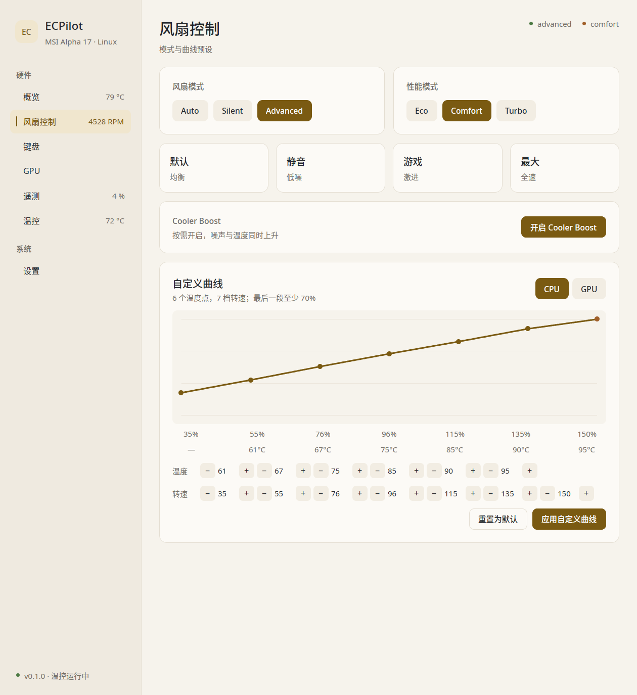
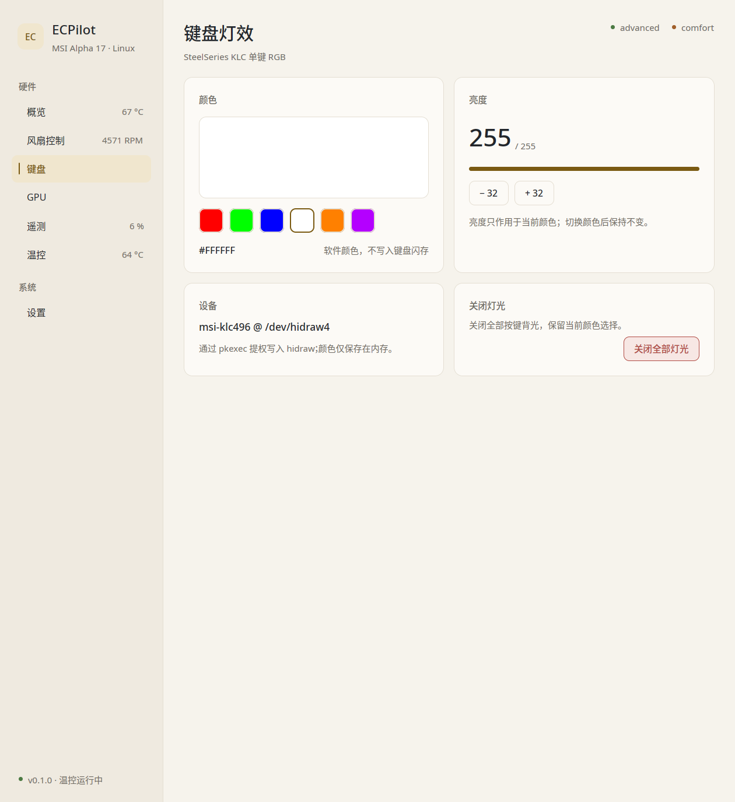
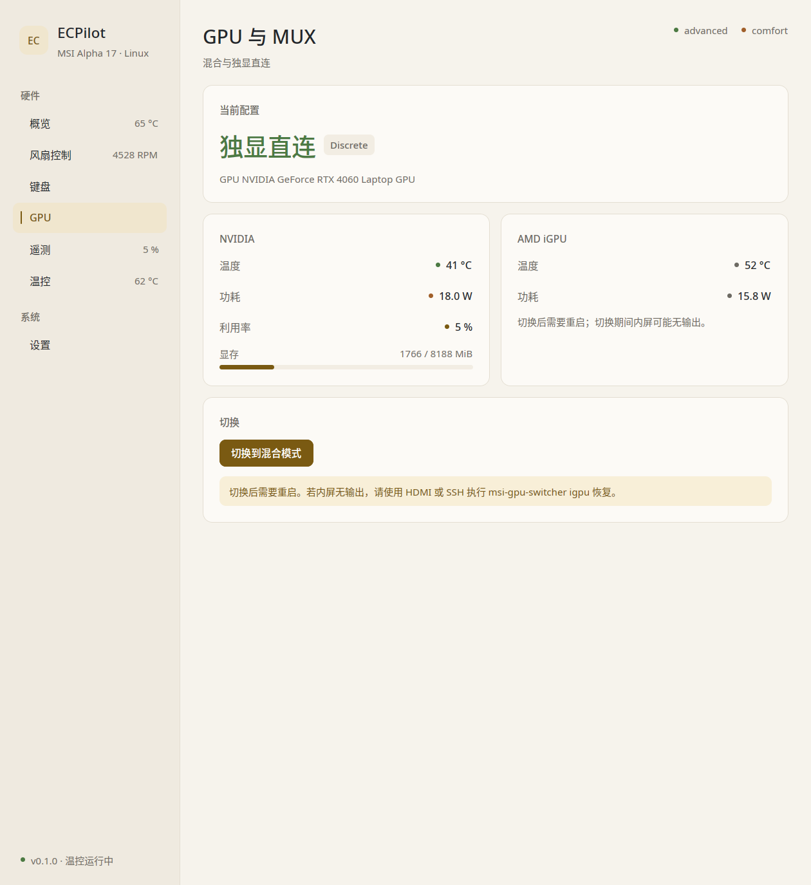
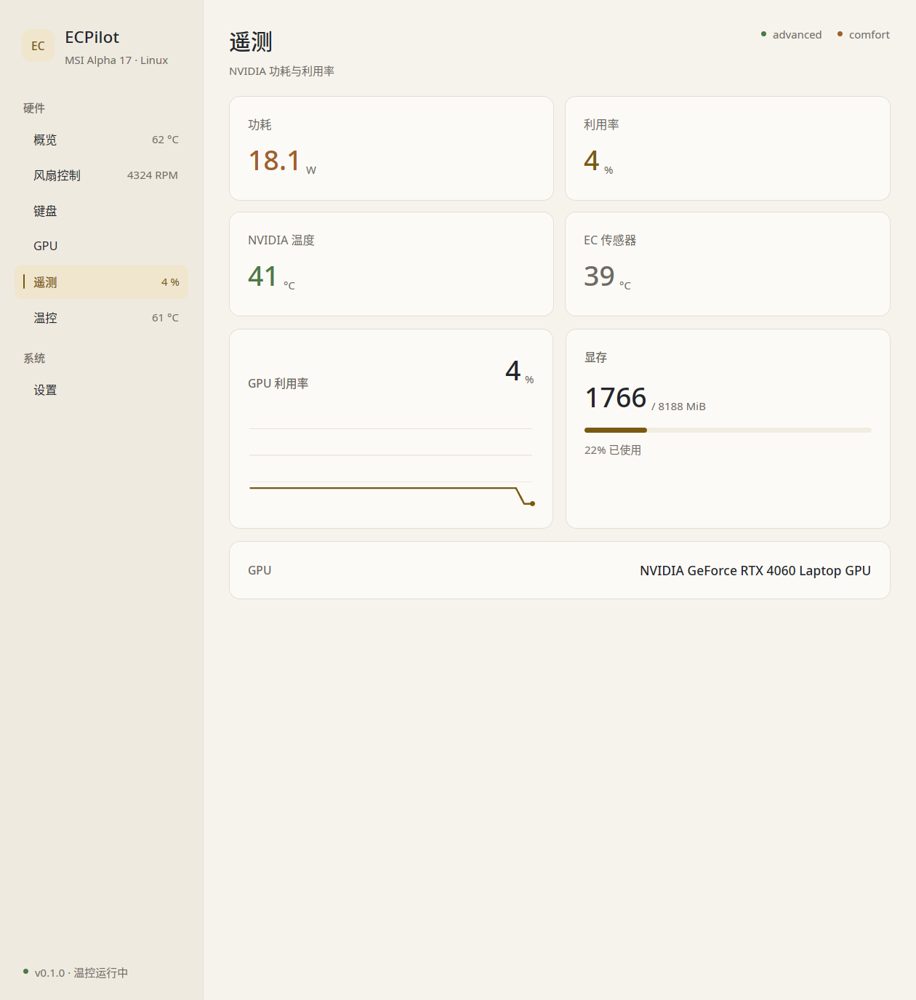
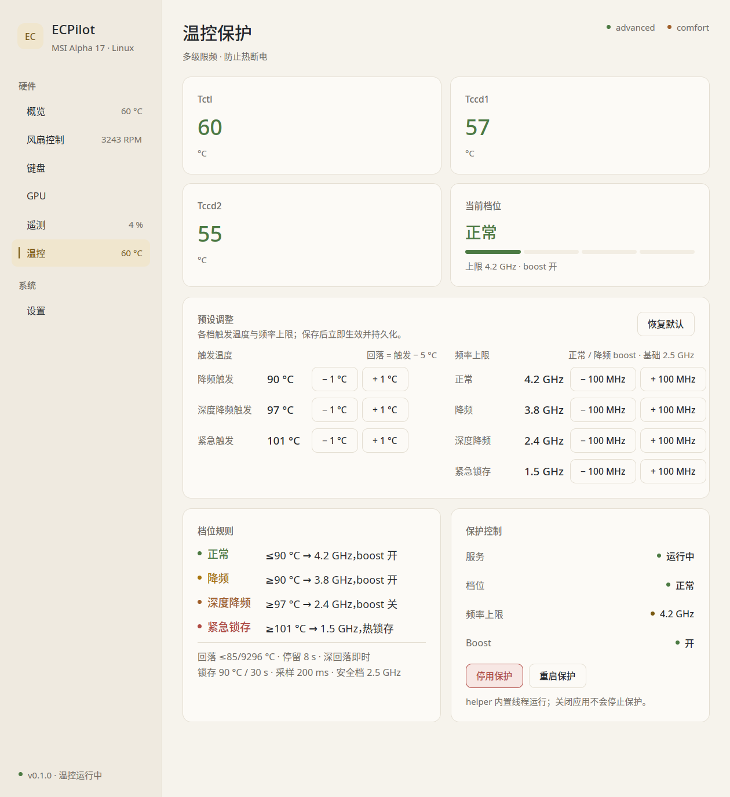
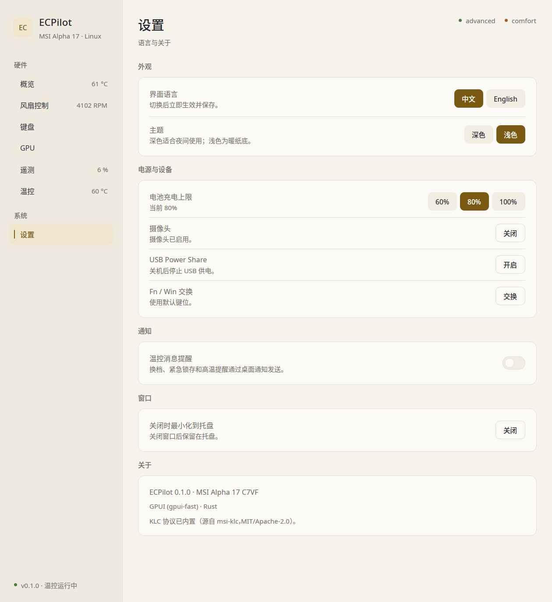

# ECPilot

A Rust + GPUI control center for MSI laptops on Linux, with SteelSeries KLC
per-key RGB support built in.

It talks directly to the `msi-ec` sysfs interface, the embedded controller and
the KLC hidraw device rather than wrapping vendor tools. The UI runs as your
desktop user; every privileged write goes through a small root D-Bus helper.
This is an independent project and does not modify or depend on the Qt-based
`MControlCenter` working tree.



## Screenshots

<table>
  <tr>
    <td width="50%"><br>
      <sub><b>风扇控制 / Fan</b> — modes, presets, editable curve, Cooler Boost</sub></td>
    <td width="50%"><br>
      <sub><b>键盘 / Keyboard</b> — KLC solid color, brightness, all-off</sub></td>
  </tr>
  <tr>
    <td><br>
      <sub><b>GPU 与 MUX</b> — discrete/hybrid status, live NVIDIA and iGPU telemetry</sub></td>
    <td><br>
      <sub><b>遥测 / Telemetry</b> — GPU power, utilization, temperatures, VRAM</sub></td>
  </tr>
  <tr>
    <td><br>
      <sub><b>温控 / Thermal</b> — guard state, editable per-level presets, protection controls</sub></td>
    <td><br>
      <sub><b>设置 / Settings</b> — language, theme, charge limit, webcam, tray behaviour</sub></td>
  </tr>
</table>

## Pages

| Page | What you get |
|---|---|
| **Overview** | CPU/GPU temperature, fan RPM, battery and charge limit, EC firmware, fan/shift mode, GPU MUX state, live history sparklines |
| **Fan** | `auto` / `silent` / `advanced`, shift mode `eco` / `comfort` / `turbo`, four curve presets (default, quiet, gaming, max), per-point curve editor (6 temperatures, 7 speeds), Cooler Boost |
| **Keyboard** | SteelSeries KLC solid colors, software brightness, quick color swatches, all-off. Covers `1038:113a` and the wider KLC family |
| **GPU** | Hybrid / Discrete MUX status, switching through `msi-gpu-switcher`, NVIDIA power/utilization/temperature/VRAM (2 s cache), iGPU temperature and power |
| **Telemetry** | GPU power, utilization, NVIDIA/EC temperatures, utilization history, VRAM usage |
| **Thermal** | Tctl/Tccd1/Tccd2, guard level and cap, editable level presets, guard enable/disable/restart, write errors |
| **Settings** | Chinese/English, dark/light theme, battery charge limit (60/80/100 %), webcam, USB Power Share, Fn/Win swap, thermal notifications, close-to-tray, about |

## Thermal guard

The guard is built into `ecpilot-helper`; no external script or systemd timer
is involved. It samples `k10temp` every 200 ms, takes the hottest of
Tctl/Tccd1/Tccd2, and writes cpufreq caps, EPP preference and boost directly.

| Level | Name | Trigger (default) | Cap | Boost |
|---|---|---|---|---|
| 0 | 正常 / Normal | ≤ 90 °C | 4.2 GHz | on |
| 1 | 降频 / Cautious | ≥ 90 °C | 3.8 GHz | on |
| 2 | 深度降频 / Aggressive | ≥ 97 °C | 2.4 GHz | off |
| 3 | 紧急锁存 / Emergency latch | ≥ 101 °C | 1.5 GHz | off |

- **Hysteresis:** each level falls back at `trigger − 5 °C`; a level only
  downshifts after an 8 s dwell when the temperature sits near its threshold.
- **Fast recovery:** when the temperature is at least 8 °C below the fallback
  threshold, the guard drops a level immediately, so a hot spike recovers in
  one latch period instead of walking down one level per 8 s.
- **Latch:** level 3 never releases until the temperature has stayed at or
  below 90 °C for 30 s. This is deliberate: short 100 °C+ bursts on this
  platform are real.
- **Presets:** the Thermal page edits each trigger temperature (± 1 °C, fallback
  derived) and each frequency cap (± 100 MHz). Level 0/1 run with boost and
  cannot go below the base frequency; levels 2/3 run without boost and cannot
  exceed it. Changes apply immediately and survive restarts; "恢复默认"
  restores the built-in values.
- **Write verification:** caps are read back every second; mismatches and
  write failures surface on the Thermal page instead of failing silently.

## Architecture

| Path | Purpose |
|---|---|
| `src/main.rs` | entry point, CLI flags, single-instance lock, window/display backend selection |
| `src/app.rs` | `AppState`, page enum, background sampling, privileged action queue, tray polling, notifications |
| `src/ui/mod.rs` | shared widgets, layout, theme application |
| `src/ui/pages/` | one module per page (overview, fan, keyboard, gpu, telemetry, thermal, settings) |
| `src/ec.rs` | unprivileged sysfs reads, zbus client for the root helper, 2 s GPU cache |
| `src/helper.rs` | root D-Bus helper: EC whitelist, batched writes, sysfs switches |
| `src/thermal.rs` | built-in thermal guard: state machine, caps/boost application and verification |
| `src/thermal_config.rs` | thermal parameters shared by the GUI and the helper |
| `src/bin/helper.rs` | standalone `ecpilot-helper` binary |
| `src/tray.rs` | minimal ksni StatusNotifierItem |
| `src/klc/` | KLC protocol, hidraw I/O, model/layout tables (ported from `msi-klc`) |
| `packaging/` | systemd unit, D-Bus policy, desktop entries, PKGBUILD, install hooks |
| `scripts/install.sh` | local `/usr/local` installer |

Data flow:

```
GPUI UI (user)
 ├─ zbus (system bus) ──> ecpilot.helper (root) ──> sysfs /dev/ec / msi-ec
 ├─ pkexec ecpilot --helper klc|mux ──> hidraw RGB, GPU MUX
 └─ sysfs reads (no privileges) ──> temperatures, fans, battery, EC status
```

## Privilege model

- The GUI runs as the desktop user; the UI itself never runs as root.
- Fan mode, curves, shift mode, battery limit, webcam, USB Power Share, Fn/Win
  swap and thermal actions go to the root `ecpilot.helper` system D-Bus
  service. The helper accepts only a whitelist of EC addresses and rejects
  arbitrary writes.
- Curve writes use one batched `putValues` call instead of 26 round trips.
- The D-Bus policy allows calls only from `root` and the `wheel` group.
- KLC RGB writes and GPU MUX switching use `pkexec <self> --helper ...`.

## Requirements

- Rust 1.85+ (edition 2024), Vulkan, Wayland/X11, fontconfig
- `msi-ec` loaded (`/sys/devices/platform/msi-ec`)
- `ec_sys write_support=1` for fan curves
- Optional: `msi-gpu-switcher` for MUX switching
- `polkit` agent for KLC RGB and MUX actions
- `wheel` group membership for the helper D-Bus policy

## Build and run

```sh
cargo build --release
./target/release/ecpilot
# open a specific page:
./target/release/ecpilot --page fan
# pages: overview, fan, keyboard, gpu, telemetry, thermal, settings
```

Install the GUI and root helper:

```sh
sudo scripts/install.sh
```

The standalone helper is `target/release/ecpilot-helper` (about 4 MB); the GUI
binary still accepts `--dbus-helper` for compatibility.

Uninstall the app and helper:

```sh
sudo scripts/uninstall.sh
sudo scripts/uninstall.sh --purge   # also remove user config
```

### Startup on niri

The binary defaults to **X11** (FluxDown-style): it removes `WAYLAND_DISPLAY`
and runs on X11/XWayland. `--x11` forces the same path; `MCC_ALLOW_WAYLAND=1`
keeps Wayland.

## Files on disk

| Path | Contents |
|---|---|
| `$XDG_CONFIG_HOME/ecpilot/config.json` | language, theme, fan mode/preset, shift mode, custom fan curve, notifications, close-to-tray |
| `/var/lib/ecpilot/thermal-enabled` | thermal guard on/off, persisted across restarts |
| `/var/lib/ecpilot/thermal-rules.json` | per-level thermal preset overrides (cleared by "恢复默认") |
| `$XDG_RUNTIME_DIR/ecpilot-<uid>.lock` | single-instance lock; a second launch wakes the running window |

The thermal guard also accepts `MCC_THERMAL_*` environment variables (for
example `MCC_THERMAL_UP1`, `MCC_THERMAL_CAP0`, `MCC_THERMAL_DWELL_MS`) on the
helper service; the GUI presets override those values.

## Development

```sh
cargo test                 # state machines, validation, KLC parsing
cargo clippy --all-targets
```

The thermal state machine, fan-curve validation and KLC byte parsing are
covered by unit tests. Pages can be opened directly with `--page <name>` for
faster iteration.

## Tested on

- MSI Alpha 17 C7VF (NVIDIA RTX 4060 Laptop GPU, SteelSeries KLC keyboard)
- Arch Linux, niri + `xwayland-satellite`
- The `msi-ec` kernel driver for fan/shift/battery/webcam controls

Other MSI models that expose the same `msi-ec` attributes should work, but the
thermal caps and fan-curve limits are tuned for this machine.

## KLC provenance

`src/klc/` is ported from
[`msi-klc`](https://github.com/echtzeit-solutions/msi-wmi-platform-dkms/tree/master/keyboard-rgb/msi-klc)
(MIT OR Apache-2.0). The original license files are kept in `src/klc/`.
The model/layout JSON files are embedded at compile time.

## Known limitations

- The X11 backend depends on niri's `xwayland-satellite`. If no X11 window
  appears, restart the niri session after a compositor update.
- The runtime is `gpui-fast` (FluxDown's GPUI fork), not upstream `gpui`.
- "Minimize to tray on close" is on by default: niri's `close-window`
  shortcut and the window close button minimize to the tray, so the tray
  stays available. Disable it in Settings if you want closing to quit the
  whole app (the tray disappears with the process). If no StatusNotifier host
  is running, closing the window quits instead of leaving the app invisible.
- Keyboard backlight (EC `0xD3`/`0xF3`) is not exposed on this model; KLC RGB
  controls the keyboard lighting instead.
- MUX switching delegates to `msi-gpu-switcher`.
- CPU bursts can genuinely reach 100 °C+ on this platform; the emergency latch
  protects the machine and releases only after the cool-down window.

## License

GPL-3.0-or-later. See [LICENSE](LICENSE).
