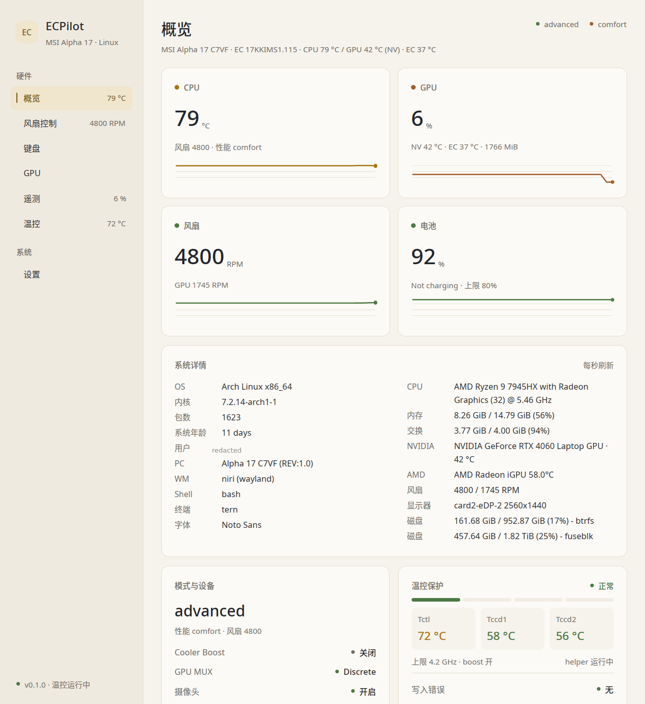
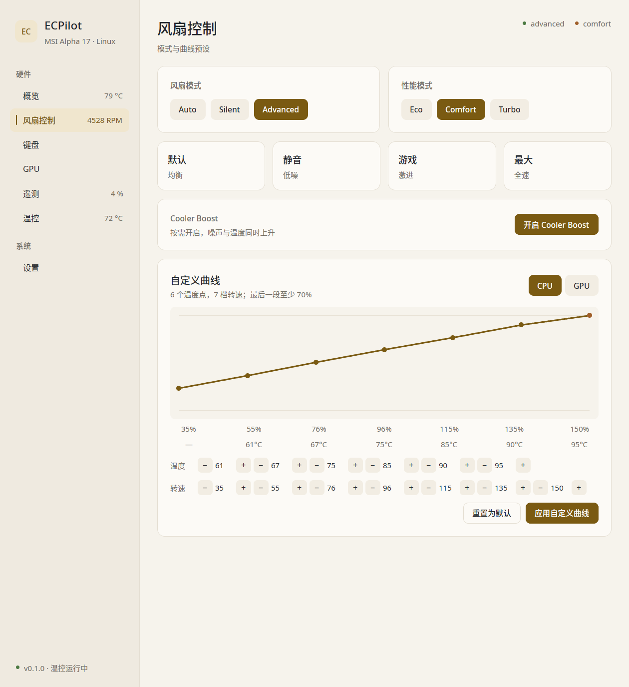
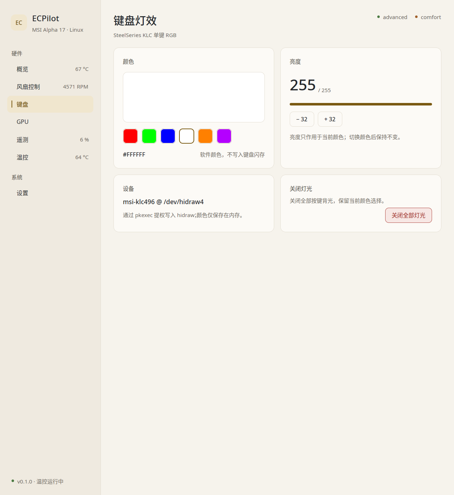
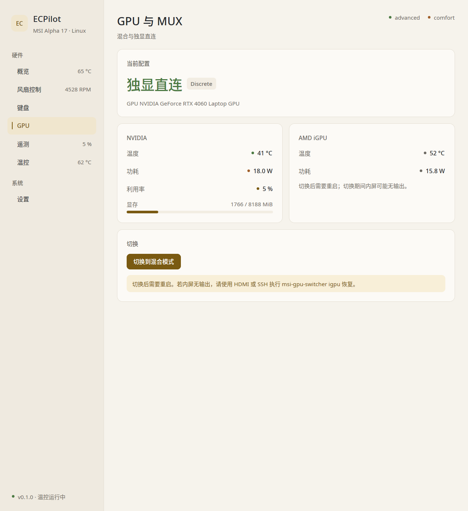
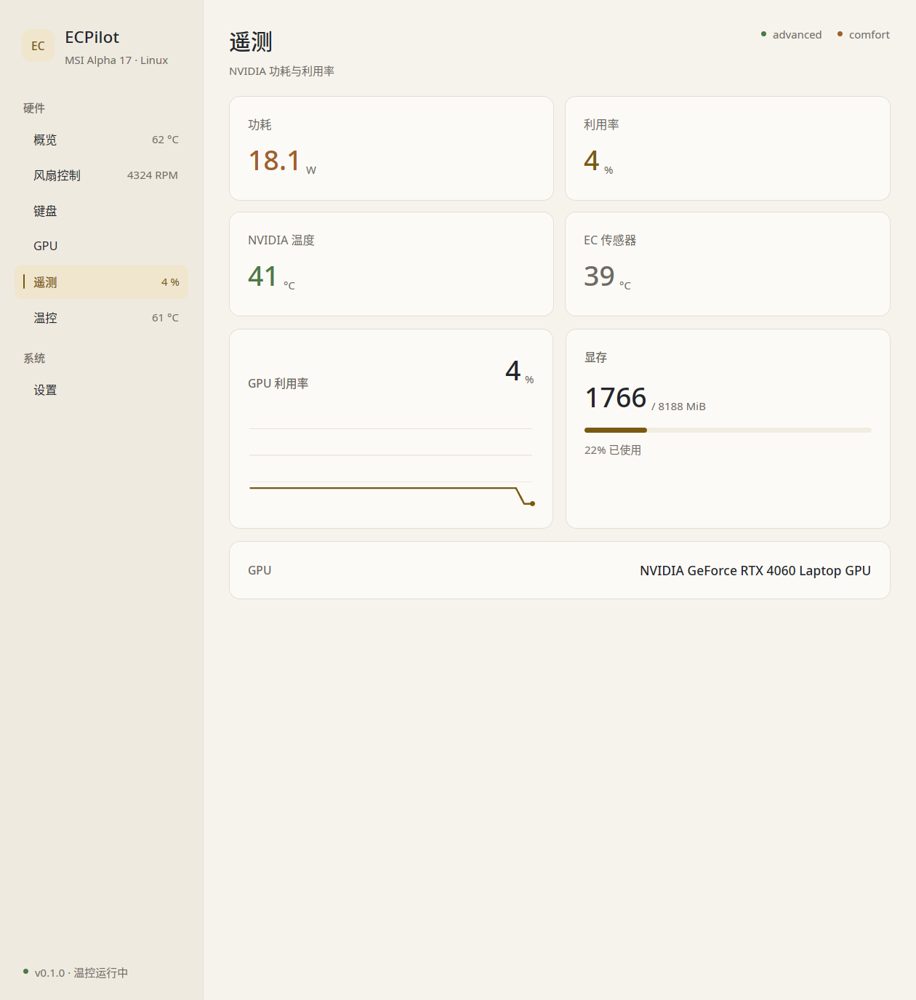
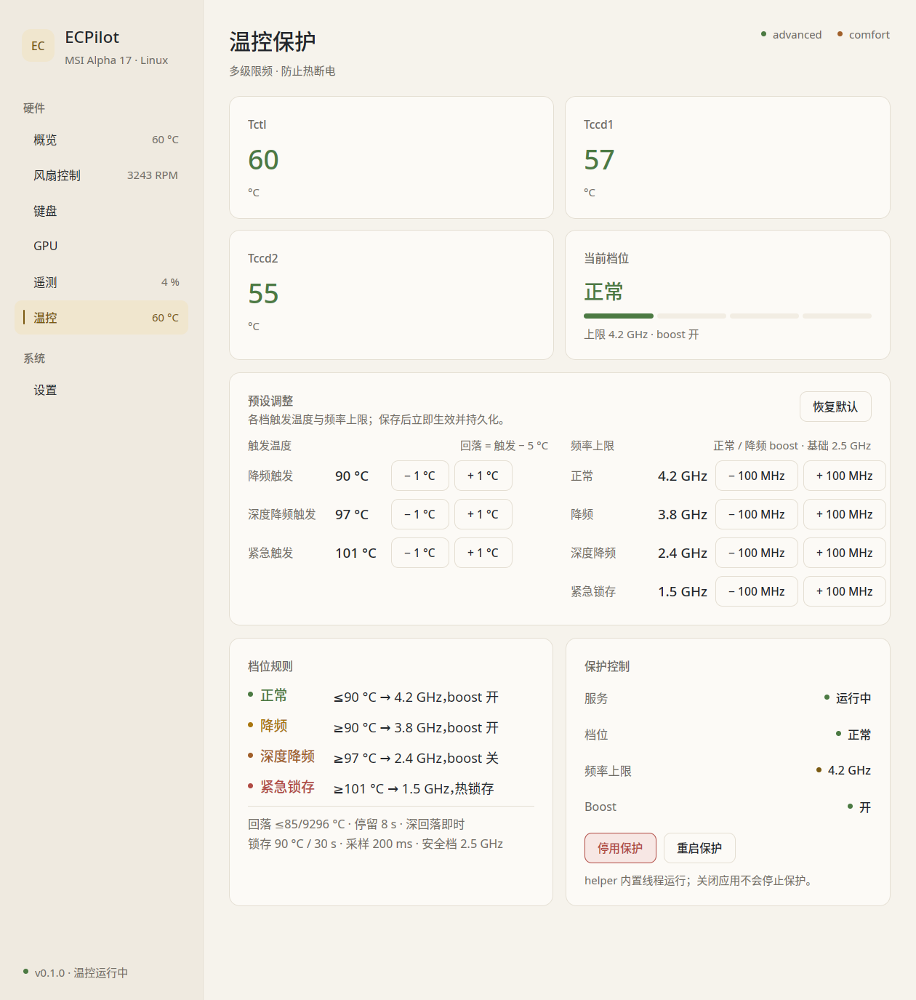
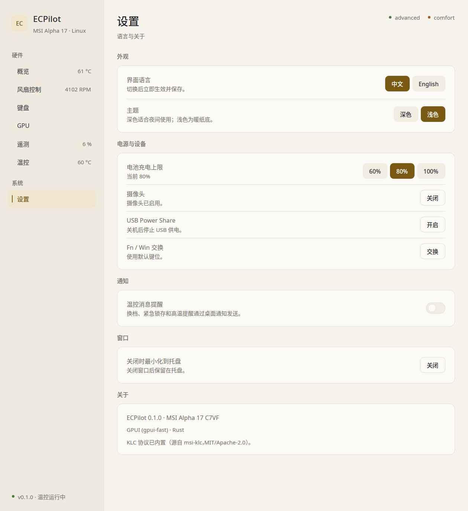

# ECPilot

[English](README.md) | **简体中文**

一个面向 Linux 的 MSI 笔记本控制中心，使用 Rust + GPUI 编写，内置 SteelSeries
KLC 单键 RGB 支持。

它直接操作 `msi-ec` sysfs 接口、嵌入式控制器（EC）和 KLC hidraw 设备，而不是封装
厂商工具。界面以普通桌面用户身份运行；所有特权写入都经过一个精简的 root D-Bus
helper。这是独立项目，不修改也不依赖基于 Qt 的 `MControlCenter` 工作树。



## 界面截图

<table>
  <tr>
    <td width="50%"><br>
      <sub><b>风扇控制</b> — 模式、预设、可编辑曲线、Cooler Boost</sub></td>
    <td width="50%"><br>
      <sub><b>键盘</b> — KLC 纯色、软件亮度、全部关闭</sub></td>
  </tr>
  <tr>
    <td><br>
      <sub><b>GPU 与 MUX</b> — 独显/混合状态、NVIDIA 与核显实时遥测</sub></td>
    <td><br>
      <sub><b>遥测</b> — GPU 功耗、利用率、温度、显存</sub></td>
  </tr>
  <tr>
    <td><br>
      <sub><b>温控</b> — 保护状态、可编辑的分档预设、保护开关</sub></td>
    <td><br>
      <sub><b>设置</b> — 语言、主题、充电上限、摄像头、托盘行为</sub></td>
  </tr>
</table>

## 页面一览

| 页面 | 内容 |
|---|---|
| **概览** | CPU/GPU 温度、风扇转速、电池与充电上限、EC 固件、风扇/性能模式、GPU MUX 状态、实时历史曲线 |
| **风扇** | `auto` / `silent` / `advanced`；性能模式 `eco` / `comfort` / `turbo`；四组曲线预设（默认、安静、游戏、最大）；逐点曲线编辑（6 个温度点、7 个转速点）；Cooler Boost |
| **键盘** | SteelSeries KLC 纯色、软件亮度、快捷色块、全部关闭。覆盖 `1038:113a` 及更广的 KLC 家族 |
| **GPU** | 混合 / 独显 MUX 状态，通过 `msi-gpu-switcher` 切换；NVIDIA 功耗/利用率/温度/显存（2 秒缓存）；核显温度与功耗 |
| **遥测** | GPU 功耗、利用率、NVIDIA/EC 温度、利用率历史、显存占用 |
| **温控** | Tctl/Tccd1/Tccd2、当前档位与上限、可编辑的分档预设、保护启停/重启、写入错误 |
| **设置** | 中英文切换、深/浅色主题、电池充电上限（60/80/100 %）、摄像头、USB Power Share、Fn/Win 交换、温控通知、关闭到托盘、关于 |

## 温控保护

温控保护内置在 `ecpilot-helper` 中，不依赖外部脚本或 systemd 定时器。它每 200 ms
采样一次 `k10temp`，取 Tctl/Tccd1/Tccd2 的最高值，并直接写入 cpufreq 上限、EPP
偏好和 boost 开关。

| 档位 | 名称 | 触发温度（默认） | 频率上限 | Boost |
|---|---|---|---|---|
| 0 | 正常 / Normal | ≤ 90 °C | 4.2 GHz | 开 |
| 1 | 降频 / Cautious | ≥ 90 °C | 3.8 GHz | 开 |
| 2 | 深度降频 / Aggressive | ≥ 97 °C | 2.4 GHz | 关 |
| 3 | 紧急锁存 / Emergency latch | ≥ 101 °C | 1.5 GHz | 关 |

- **回差**：每一档在 `触发温度 − 5 °C` 回落；温度接近阈值时，需要先满足 8 秒
  停留时间才会降档，防止在阈值附近来回振荡。
- **深回落即时降档**：温度低于回落阈值 8 °C 以上时立即降一档，因此高温冲击结束后
  一个锁存周期内即可恢复，而不是每档再等 8 秒。
- **锁存**：档位 3 必须等温度持续 30 秒不高于 90 °C 才会解除。这是刻意设计：
  该平台上短暂的 100 °C+ 冲击是真实发生的。
- **预设编辑**：温控页可调整每档触发温度（±1 °C，回落温度自动派生）和每档频率上限
  （±100 MHz）。档位 0/1 开启 boost，不能低于基础频率；档位 2/3 关闭 boost，不能
  高于基础频率。修改立即生效并持久化；「恢复默认」还原内置参数。
- **写入校验**：每秒读回一次频率上限，不一致或写入失败会显示在温控页，不会静默失败。

## 架构

| 路径 | 职责 |
|---|---|
| `src/main.rs` | 入口、命令行参数、单实例锁、窗口/显示后端选择 |
| `src/app.rs` | `AppState`、页面枚举、后台采样、特权操作队列、托盘轮询、桌面通知 |
| `src/ui/mod.rs` | 通用控件、布局、主题应用 |
| `src/ui/pages/` | 每个页面一个模块（概览、风扇、键盘、GPU、遥测、温控、设置） |
| `src/ec.rs` | 无特权的 sysfs 读取、root helper 的 zbus 客户端、2 秒 GPU 缓存 |
| `src/helper.rs` | root D-Bus helper：EC 地址白名单、批量写入、sysfs 开关 |
| `src/thermal.rs` | 内置温控：状态机、频率/boost 应用与读回校验 |
| `src/thermal_config.rs` | GUI 与 helper 共享的温控参数定义 |
| `src/bin/helper.rs` | 独立的 `ecpilot-helper` 可执行文件 |
| `src/tray.rs` | 极简 ksni StatusNotifierItem 托盘 |
| `src/klc/` | KLC 协议、hidraw I/O、型号/布局表（移植自 `msi-klc`） |
| `assets/icons/` | 应用/托盘图标源文件（SVG）与各尺寸 PNG |
| `packaging/` | systemd unit、D-Bus 策略、desktop 文件、PKGBUILD、安装钩子 |
| `scripts/install.sh` | 本地 `/usr/local` 安装脚本 |

数据流：

```
GPUI 界面（普通用户）
 ├─ zbus（系统总线）──> ecpilot.helper（root）──> sysfs /dev/ec / msi-ec
 ├─ pkexec ecpilot --helper klc|mux ──> hidraw RGB、GPU MUX
 └─ sysfs 只读 ──> 温度、风扇、电池、EC 状态
```

## 权限模型

- 界面以桌面用户运行，UI 自身永远不以 root 运行。
- 风扇模式、曲线、性能模式、充电上限、摄像头、USB Power Share、Fn/Win 交换与温控
  操作都发给 root 的 `ecpilot.helper` 系统 D-Bus 服务。helper 只接受白名单内的 EC
  地址，拒绝任意写入。
- 曲线写入使用一次批量 `putValues` 调用，避免 26 次往返。
- D-Bus 策略只允许 `root` 和 `wheel` 组调用。
- KLC RGB 写入与 GPU MUX 切换使用 `pkexec <self> --helper ...`。

## 运行要求

- Rust 1.85+（edition 2024）、Vulkan、Wayland/X11、fontconfig
- 已加载 `msi-ec`（`/sys/devices/platform/msi-ec`）
- 风扇曲线需要 `ec_sys write_support=1`
- 可选：MUX 切换需要 `msi-gpu-switcher`
- KLC RGB 与 MUX 操作需要 `polkit` 代理
- helper 的 D-Bus 策略要求用户属于 `wheel` 组

## 构建与运行

```sh
cargo build --release
./target/release/ecpilot
# 打开指定页面：
./target/release/ecpilot --page fan
# 页面名：overview, fan, keyboard, gpu, telemetry, thermal, settings
```

安装 GUI 与 root helper：

```sh
sudo scripts/install.sh
```

独立 helper 是 `target/release/ecpilot-helper`（约 4 MB）；GUI 可执行文件仍保留
`--dbus-helper` 以兼容旧用法。

卸载：

```sh
sudo scripts/uninstall.sh
sudo scripts/uninstall.sh --purge   # 同时删除用户配置
```

### 在 niri 上启动

可执行文件默认走 **X11**（FluxDown 风格）：它会移除 `WAYLAND_DISPLAY`，在
X11/XWayland 上运行。`--x11` 强制同一路径；`MCC_ALLOW_WAYLAND=1` 则保留 Wayland。

## 磁盘上的文件

| 路径 | 内容 |
|---|---|
| `$XDG_CONFIG_HOME/ecpilot/config.json` | 语言、主题、风扇模式/预设、性能模式、自定义风扇曲线、通知、关闭到托盘 |
| `/var/lib/ecpilot/thermal-enabled` | 温控保护启停状态，跨重启保留 |
| `/var/lib/ecpilot/thermal-rules.json` | 分档温控预设覆盖（「恢复默认」会清除） |
| `$XDG_RUNTIME_DIR/ecpilot-<uid>.lock` | 单实例锁；再次启动会唤醒已运行的窗口 |

温控还接受 helper 服务上的 `MCC_THERMAL_*` 环境变量（如 `MCC_THERMAL_UP1`、
`MCC_THERMAL_CAP0`、`MCC_THERMAL_DWELL_MS`）；GUI 里保存的预设会覆盖这些值。

## 开发

```sh
cargo test                 # 状态机、校验、KLC 解析
cargo clippy --all-targets
```

温控状态机、风扇曲线校验和 KLC 字节解析都有单元测试覆盖。调试时可用
`--page <name>` 直接打开指定页面。

## 已验证环境

- MSI Alpha 17 C7VF（NVIDIA GeForce RTX 4060 Laptop GPU、SteelSeries KLC 键盘）
- Arch Linux，niri + `xwayland-satellite`
- 风扇/性能模式/电池/摄像头控制依赖 `msi-ec` 内核驱动

其他暴露相同 `msi-ec` 属性的 MSI 机型理论上可用，但温控频率上限与风扇曲线范围是
按本机调校的。

## KLC 来源

`src/klc/` 移植自
[`msi-klc`](https://github.com/echtzeit-solutions/msi-wmi-platform-dkms/tree/master/keyboard-rgb/msi-klc)
（MIT OR Apache-2.0）。原始许可证文件保留在 `src/klc/` 中。型号/布局 JSON 在编译期
嵌入。

## 已知限制

- X11 后端依赖 niri 的 `xwayland-satellite`。若没有出现 X11 窗口，请在合成器更新后
  重启 niri 会话。
- 运行时是 `gpui-fast`（FluxDown 的 GPUI 分支），不是上游 `gpui`。
- 默认开启「关闭时最小化到托盘」：niri 的 `close-window` 快捷键和窗口关闭按钮都会
  最小化到托盘，托盘得以保留。若希望关闭即退出整个应用，可在设置中关闭（进程退出后
  托盘也随之消失）。没有 StatusNotifier 宿主时会直接退出，而不是留下不可见的进程。
- 本机型未暴露键盘背光（EC `0xD3`/`0xF3`）；键盘灯由 KLC RGB 控制。
- MUX 切换委托给 `msi-gpu-switcher`。
- 该平台的 CPU 突发确实可能达到 100 °C+；紧急锁存用于保护机器，并只在冷却窗口
  满足后解除。

## 许可证

GPL-3.0-or-later。见 [LICENSE](LICENSE)。
